# Module 4 - End of Module Assignment: TaskFlow API - Dockerize & Deploy

This document serves as the starting point for the TaskFlow project. It begins with what the assignment asked for, explains the design choices and why they were made, and then describes how they were built. Each section provides links to related documents and repositories with the full details, so you can read this one first and go deeper only where you need to.

## Document map

| If you want to... | Read |
|---|---|
| Understand the whole project in one pass | This document |
| See why the deployment looks the way it does | [Swarm design and motivation][swarm-design] |
| Deploy, run a failover drill or tear down | [Swarm architecture and runbook][swarm-runbook] |
| Rebuild the environment from nothing | [Swarm setup guide][swarm-setup] |
| Create the VMs and swarm with Terraform | [Terraform README][swarm-terraform] |
| Work on the login and token-signing service | [Users service README][users-readme], [authentication][users-auth] |
| Work on the task service | [Tasks API README][tasks-readme], [authentication][tasks-auth] |
| Work on the web front end | [Web app README][web-readme] |
| Understand the CI/CD pipeline | [Users API deployment (CI/CD)][users-deploy], [Tasks API deployment (CI/CD)][tasks-deploy] |
| Understand the security checks in CI | [Users security checks][users-security], [Tasks security checks][tasks-security] |

---

## 1. The assignment

### 1.1 What was asked

The brief is the **Module 4 end-of-module assignment, "TaskFlow API - Dockerize & Deploy"** (AI Engineering, Module 4 DevOps, NTU). It is graded pass/fail and encourages experimenting, taking on stretch goals, and reporting errors honestly in the README.

The mandatory part takes the Module 3 TaskFlow API and:

1. **Dockerfile:** containerize it with the multi-stage `Dockerfile` given in the brief (Maven build stage, `eclipse-temurin:21-jre-alpine` runtime stage).
2. **Build and test locally:** `docker build`, `docker run`, then `curl /api/tasks`.
3. **Deploy to Railway** from the GitHub repository and generate a public domain.
4. **Verify the deployment:** call the live URL and take screenshots of the dashboard and the working URL.

The submission is a GitHub repository whose `README.md` holds the live URL, the screenshots, any errors and failures, and the stretch goals attempted.

The five optional stretch goals are: (1) a CI pipeline that builds, tests and publishes the image to Docker Hub; (2) a frontend that calls the API; (3) the Simple CRM project instead of TaskFlow; (4) versioned Docker images; (5) security checks with OWASP Dependency-Check, an image scanner, and no committed secrets.

### 1.2 How the project answers it

The brief's subject is **DevOps: containers, pipelines and deployment**. These practices are easiest to demonstrate on a **microservice** system, where several independently built services have to be deployed, connected and updated without breaking each other. The Module 3 TaskFlow API was therefore split into three parts:

| Part | Role | Technology | Docs |
|---|---|---|---|
| **Users service** | Login, user management; signs JWTs with an RSA private key | Spring Boot 4.1, Spring Security 7, JJWT 0.13, PostgreSQL 16 | [README][users-readme] |
| **Tasks API** | The TaskFlow task endpoints; only *verifies* JWTs with the public key | Spring Boot 4.1, Spring Security 7, JJWT 0.13, PostgreSQL 16 | [README][tasks-readme] |
| **Web app** | User interface with a backend-for-frontend (BFF) that calls both APIs | Next.js on Vercel | [README][web-readme] |

Each API has its own codebase, container image, database, pipeline and release cycle. A change to one is built, tested, versioned and deployed without touching the other, which is the point a single monolith could not make.

### 1.3 Mandatory tasks: what was done

| Task | Brief | What was done | Where to look |
|---|---|---|---|
| 1. Dockerfile | Multi-stage `Dockerfile` given in the brief | Kept the two-stage pattern and hardened the runtime stage: non-root user, `apk upgrade` on every build, no `curl`, a liveness health check, and each service's own port (8022, 8077) instead of 8080 | [Users Dockerfile](https://github.com/ensanguine2279/sctp-aie-m4-assignment-api-users/blob/main/Dockerfile), [Tasks Dockerfile](https://github.com/ensanguine2279/sctp-aie-m4-assignment-api-tasks/blob/main/Dockerfile) |
| 2. Build and test locally | `docker build`, `docker run`, `curl /api/tasks` | Each API runs locally with Docker Compose, its own Postgres, and its JWT key mounted as a secret. `/api/tasks` needs a token, so a bare `curl` returns 401; the smoke test logs in first, exercises the endpoints and checks that forged tokens are rejected | [Users compose](https://github.com/ensanguine2279/sctp-aie-m4-assignment-api-users/blob/main/docker-compose.yml), [Tasks compose](https://github.com/ensanguine2279/sctp-aie-m4-assignment-api-tasks/blob/main/docker-compose.yml), [Users authentication][users-auth], [Tasks authentication][tasks-auth] |
| 3. Deploy to Railway | Deploy from GitHub, generate a domain | **Railway was the plan, but it had an outage and a security incident.** The deployment moved to a three-node Docker Swarm on Google Cloud, behind Caddy with HTTPS ([Section 3.2](#32-how-the-platform-was-chosen)) | [Swarm design][],  [Swarm setup][swarm-setup] |
| 4. Verify the deployment | `curl` the live URL, screenshots | API Live at `https://sctp-aie-m4-apigw.work.gd` (token required). Screenshots in section 1.5 | [Section 1.5](#15-live-url-and-screenshots) |

### 1.4 Stretch goals

The brief asks for one stretch goal. Four were taken on, and they build on each other: the CI pipeline runs the security checks, publishes the versioned images and deploys them.

| Option | Status | What was built | Evidence |
|---|---|---|---|
| 1. CI pipeline to Docker Hub | Done | GitHub Actions: tests and security scans, release, build and push to Docker Hub, then deploy to the swarm. Docker Hub credentials are repository secrets | [Users API CI/CD pipeline][users-deploy], [Tasks API CI/CD pipeline][tasks-deploy], [Section 4.4](#44-cicd-and-the-security-gate). Successful run: `<add link>`, [User service Docker Hub images](https://hub.docker.com/repository/docker/ensanguine/user-service/general), [Task service Docker Hub images](https://hub.docker.com/repository/docker/ensanguine/task-service/general) |
| 2. Frontend | Done, on **Vercel instead of Netlify** | Next.js app with a BFF. The browser only talks to Vercel and the BFF calls the APIs server-side, so the APIs need no CORS configuration | [Web app README][web-readme]. Frontend URL: <https://taskmaster-hakngrow.vercel.app> (Login required) |
| 3. Simple CRM instead of TaskFlows | Not taken | | |
| 4. Versioned images | Done | semantic-release derives `MAJOR.MINOR.PATCH` from commit messages; images are also tagged with the commit SHA, and the swarm deploys by digest | [Section 4.4](#44-cicd-and-the-security-gate). Docker Hub tags screenshot in [Section 1.5](#15-live-url-and-screenshots) |
| 5. Security checks | Done for the users service; tasks API files ready, rollout pending | OWASP Dependency-Check, Trivy image scan, gitleaks over the whole history, and a project script that fails on committed keys, `.env` files or default secrets. All run in CI and gate the release | [Users security checks][users-security], [Tasks security checks][tasks-security] |

Beyond the brief: two cooperating services with asymmetric JWTs, two replicas of each API across three nodes, rolling updates with automatic rollback, HTTPS, and optional Terraform for the infrastructure.

### 1.5 Live URL and screenshots
- **Authentication Endpoint** `https://sctp-aie-m4-apigw.work.gd/auth/login`
- **Live API:** `https://sctp-aie-m4-apigw.work.gd/api/users` (attach a BEARER token from `POST /auth/login`)
- **Live API:** `https://sctp-aie-m4-apigw.work.gd/api/tasks` (attach a BEARER token from `POST /auth/login`)
- **OpenAPI Specification:** [open-api-spec.yaml](open-api-spec.yaml)
- **Frontend:** <https://taskmaster-hakngrow.vercel.app/login>

With no Railway dashboard, the deployment is shown through the swarm itself via Portainer:

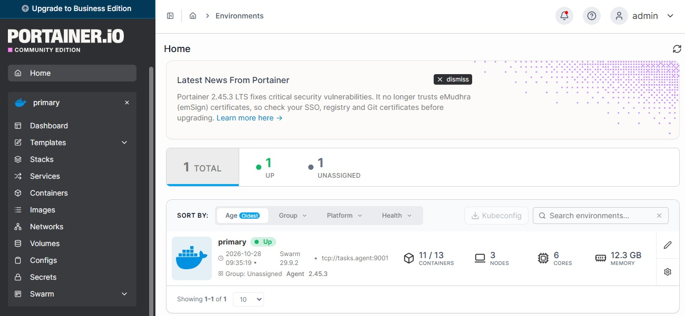

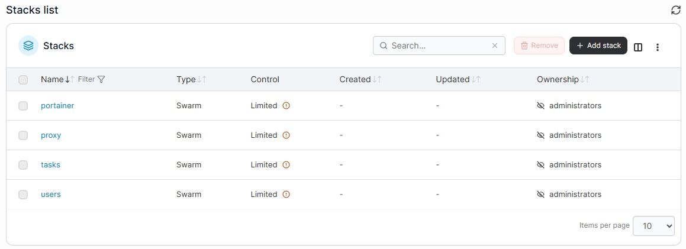

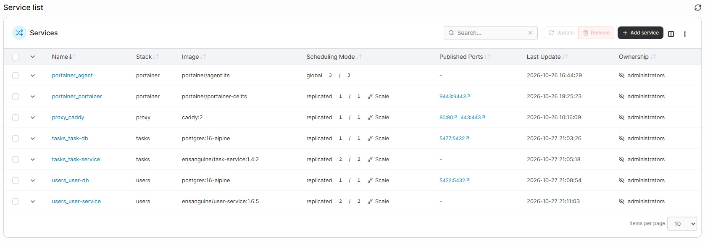

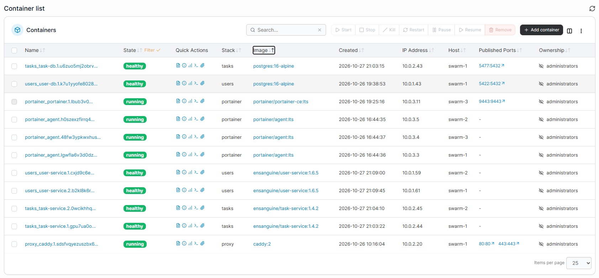

#### Live API - authentication
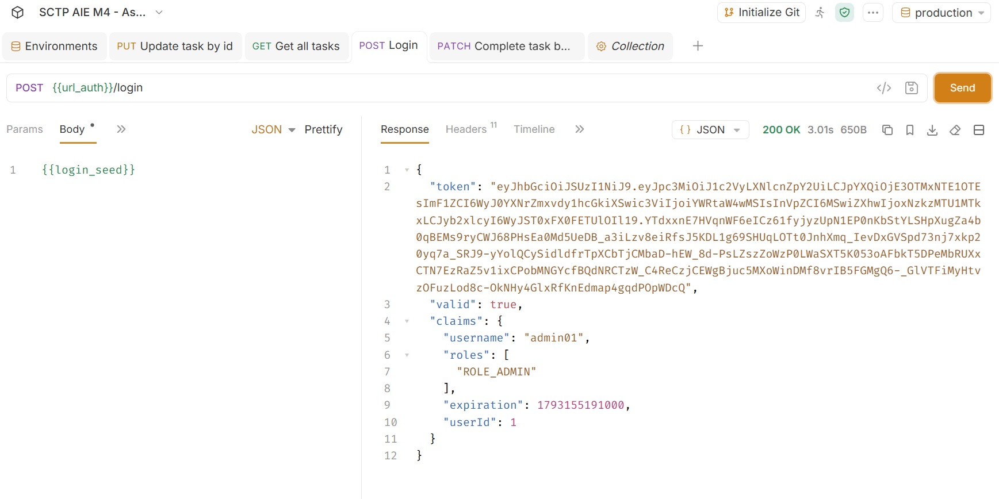

#### Live API - Get all tasks (with JWT token)
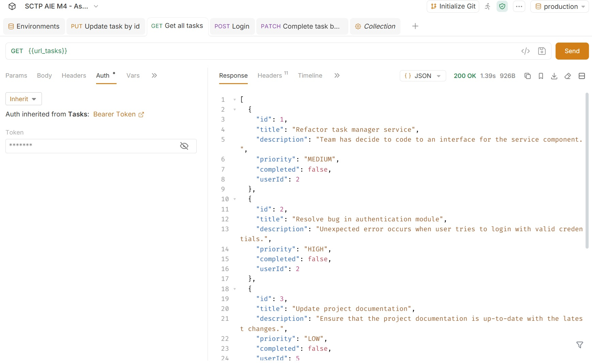

#### Live API - Create task (with JWT token)
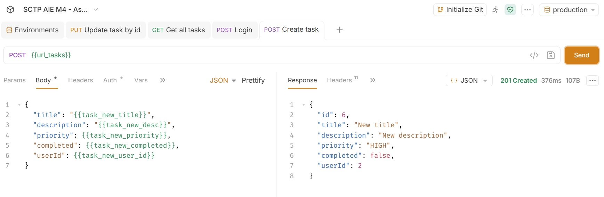

#### Docker Hub - User Service - Tags
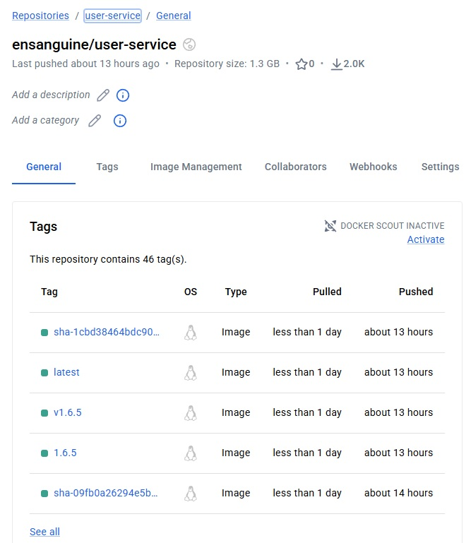

#### GitHub Actions - Pipeline
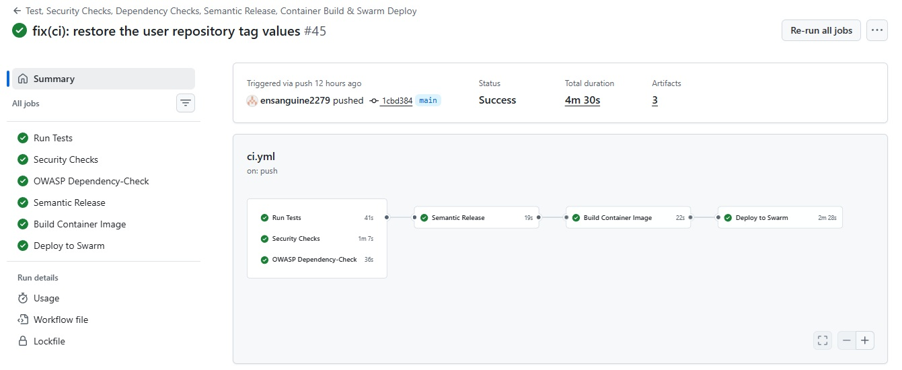

### 1.6 Errors and failures

The brief asks for errors and failures to be reported. The main ones, and how each was handled:

| What went wrong | Outcome | Details |
|---|---|---|
| Railway outage and security incident | Deployment moved to a self-managed Docker Swarm | [Section 3.2](#32-how-the-platform-was-chosen) |
| Play with Docker deprecated | Not usable as a free swarm host | [Section 3.2](#32-how-the-platform-was-chosen) |
| Oracle Cloud free tier: `500-InternalError, Out of host capacity` | No free ARM VMs could be created; moved to the GCP free trial | [Section 3.2](#32-how-the-platform-was-chosen) |
| Trivy: CVEs in `curl`, `libcurl` and `brotli-libs` in the runtime image | Removed `curl`, switched the health check to BusyBox `wget`, `apk upgrade` on every build | [Users security checks][users-security] |
| Dependency-Check: Spring Boot 4.1.1 ships Tomcat 11.0.24 with 11 CVEs | Upgraded to Spring Boot 4.1.2 | [Users security checks][users-security] |
| `aquasecurity/trivy-action` tags hijacked (GHSA-69fq-xp46-6x23) | Action pinned by commit SHA | [Users security checks][users-security] |
| NVD API key request form hung | Dependency-Check uses its own NVD mirror instead | [Users security checks][users-security] |

Smaller issues hit along the way are recorded as gotchas in their respective [documents](#7-full-document-index).

---

## 2. The system at a glance

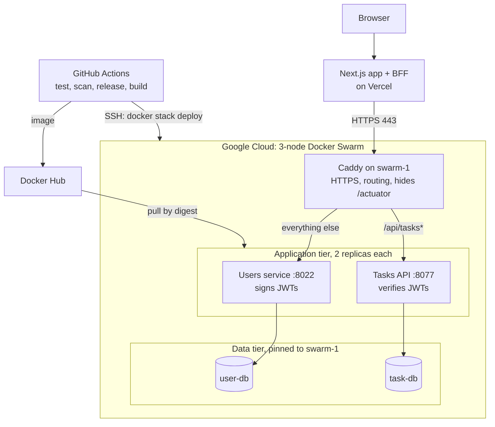

Public entry point: `https://sctp-aie-m4-apigw.work.gd`.

---

## 3. Design and motivation

This section summarises the reasoning. The full version, with every trade-off, is in the [Swarm design and motivation][swarm-design] document.

### 3.1 Why two services and not one

Splitting the application along a security boundary gives a natural microservice cut: one service *issues* identity, the other *consumes* it. That split also drives the key design ([Section 3.4](#34-security-model)), so the architecture and the security model reinforce each other rather than being two separate concerns.

### 3.2 How the platform was chosen

The original plan was to deploy on **Railway**, a managed platform that would have run the Spring Boot services with little infrastructure work. Railway then had an outage and a security incident, and the project could not rely on it. The deployment pivoted to a self-managed **Docker Swarm**, which also exposes the orchestration and networking layers a managed platform hides: a better fit for a DevOps assignment.

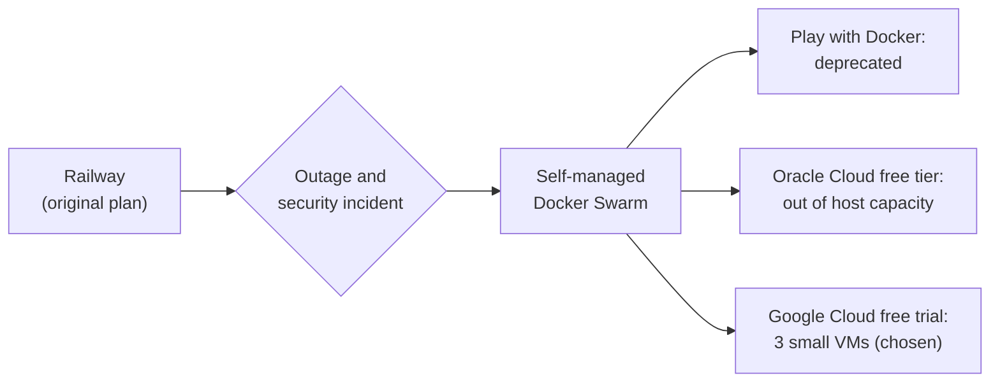

Cost was the main constraint. The GCP free trial (US$300, 90 days) covers three `e2-medium` VMs, as long as the environment is torn down before the trial ends. Three VMs matter more than their size: a Swarm manager quorum needs a majority alive, so three is the smallest cluster that survives losing a node.

The Railway plan left one lasting trace in the code: the users service can take its private key as `JWT_PRIVATE_KEY_BASE64`, for platforms that cannot mount files. See [users authentication](https://github.com/ensanguine2279/sctp-aie-m4-assignment-api-users/blob/main/README-authentication.md).

### 3.3 Why Swarm and not Kubernetes

| Factor | Docker Swarm | Kubernetes |
|---|---|---|
| Starting point | Existing `docker-compose.yml` files become stack files with small edits | New manifests or Helm charts |
| Footprint | Built into Docker; fits on 4 GB VMs with room for the apps | The control plane alone takes a large share of a 4 GB node |
| Features needed | Replicas, rolling updates, health checks, rollback, secrets, placement | The same, plus far more than this project needs |

Swarm gives every property the assignment needs with the least machinery. The trade-off is a smaller ecosystem and no built-in autoscaling.

### 3.4 Security model

The security design is the thread that runs through every layer:

- **Asymmetric tokens (RS256).** Only the users service holds the private key. The tasks API holds only `public.pem` and contains no token-issuing code (CI fails the build if it does). A compromised tasks API cannot forge a login.
- **Strict validation.** Every token is checked for RS256 only, issuer, audience, expiry (30 s skew) and a positive `uid` claim. HS256 and unsigned tokens are rejected.
- **Ownership, not just roles.** In the tasks API, ADMIN and MANAGER see every task; anyone else sees only their own, and someone else's task is a 404, indistinguishable from a missing one.
- **Keys never travel with the code.** Not in Git, not in an image, not in `.env`. In the swarm they are Swarm secrets mounted as files.
- **One public door.** Only Caddy (80, 443) and SSH (22) are reachable from the internet. Databases and Portainer are reached through SSH tunnels.
- **The token never reaches browser JavaScript.** The BFF keeps it in an httpOnly cookie.

Details: [users authentication][user-auth], [tasks authentication][tasks-auth], [web app][web-readme].

### 3.5 Design decisions at a glance

| # | Decision | Main benefit | Main trade-off |
|---|---|---|---|
| D1 | Three nodes, all managers | Survives one node loss | Managers also run workloads |
| D2 | One stack per concern (`users`, `tasks`, `proxy`, `portainer`) | Independent deploys, isolated networks | Caddy joins both networks as external |
| D3 | Caddy as the only door | Free TLS, one hostname, hidden actuator | Single proxy node |
| D4 | Databases pinned, not replicated | Simple, no shared storage | Data tier not highly available |
| D5 | JWT keys as Swarm secrets, split by role | Tasks API cannot mint tokens | Rotate by renaming the secret |
| D6 | Liveness health check | Safe rollouts, no restarts on database blips | Actuator probes must be permitted |
| D7 | Start-first updates with rollback | No downtime, self-reverting | Needs spare memory |
| D8 | Restart policy instead of `depends_on` | Survives start-order races | A few failed starts at boot |
| D9 | Image references by digest | Every node runs the exact image CI built | Longer image strings |
| D10 | Admin access only through SSH tunnels | No extra public ports | Tunnel needed each time |
| D11 | Three public ports (22, 80, 443) | Small attack surface | Port 22 still public |
| D12 | Front end stays on Vercel | Already working, no VM load | Caddy sees Vercel IPs only |
| D13 | Free domain from DNSExit | HTTPS at no cost | Depends on the provider's terms |

Each decision is explained in full in the [design document][swarm-design], [Section 4](#4-architectural-implementation).

---

## 4. Architectural implementation

### 4.1 Application tier

The two APIs share a token contract. If they disagree on issuer or audience, every token fails with a 401 that looks like a signature problem.

| Claim | Value |
|---|---|
| Algorithm | `RS256` |
| `iss` | `user-service` (`JWT_ISSUER`) |
| `aud` | `taskflow-api` (`JWT_AUDIENCE`), serialised as an array |
| `sub` | username, lowercase |
| `uid` | user's database id; required by the tasks API |
| `roles` | strings starting with `ROLE_`, e.g. `["ROLE_ADMIN"]` |
| `iat`, `exp` | default lifetime one hour |

**Users service** issues and validates tokens, derives its public key from the private key at startup, and serves login and user management. See the [README][users-readme] and [authentication][users-auth] docs.

**Tasks API** verifies tokens with the public key only, enforces the role matrix with `@PreAuthorize` and task ownership with `TaskAccessPolicy`, and accepts request DTOs (never the entity), so a client cannot set `id` or `userId`. See the [README][tasks-readme] and [authentication][tasks-auth] docs.

**Web app** runs on Vercel. Its BFF calls the APIs server-side, so the APIs need no CORS configuration. See the [web app README][web-readme].

### 4.2 Request path

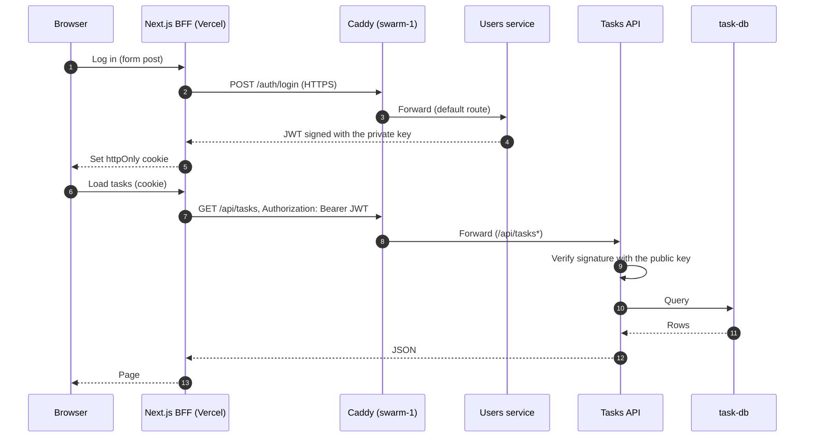

### 4.3 Containerization

Both APIs use the same image pattern: a multi-stage build onto `eclipse-temurin:21-jre-alpine`, running as a non-root user, with `apk upgrade` on every build and no `curl`. Fewer packages means fewer CVEs for Trivy to find. The health check calls `/actuator/health/liveness` with BusyBox `wget` on `127.0.0.1`. Liveness ignores the database, so a short Postgres outage does not make Swarm kill healthy replicas (design D6).

Locally, each API runs with its own Docker Compose stack, mounting only the key it needs as a secret: the private key for users (app 8022, database 5422), the public key for tasks (app 8077, database 5433).

| | Users service | Tasks API |
|---|---|---|
| Image | [README-Dockerfile][users-dockerfile] | [README-Dockerfile][tasks-dockerfile] |
| Local stack | [README-docker-compose][users-compose] | [README-docker-compose][tasks-compose] |

### 4.4 CI/CD and the security gate

Both API repositories use the same workflow file; only five values at the top differ (image name, stack name, stack file, env file, service name).

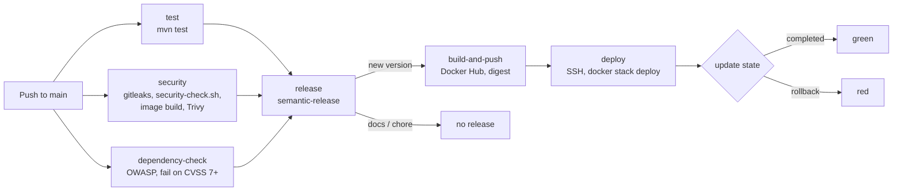

- **Nothing ships unless every check passes.** A failed test or scan means no tag, no image and no deploy.
- **Versions come from commit messages:** `fix:` patch, `feat:` minor, `feat!:` major; `docs:` and `chore:` release nothing.
- **The deploy waits for the result** and fails the run if Swarm rolls back, so a green run means healthy replicas.
- **The stack file in Git is the source of truth**; the job copies it to `swarm-1` on every deploy.
- **Findings are never silenced to pass.** False positives are suppressed only with a reason and an expiry date.

Details: [users CI/CD pipeline][users-deploy], [tasks CI/CD pipeline][tasks-deploy], [users security checks][users-security], [tasks security checks][tasks-security].

### 4.5 Infrastructure

| Node | Role | Runs |
|---|---|---|
| `swarm-1` | Manager, static public IP | Caddy, `user-db`, `task-db`, API replicas, Portainer agent |
| `swarm-2` | Manager | API replicas, Portainer agent |
| `swarm-3` | Manager | API replicas, Portainer server, Portainer agent |

- **VMs, firewall, swarm:** built by hand following the [setup guide][swarm-setup], or by `terraform apply` with the [Terraform project][terraform]. Env files and JWT keys are created by hand on `swarm-1` in both cases, so they never enter Terraform state.
- **Caddy** terminates HTTPS with a Let's Encrypt certificate, routes `/api/tasks*` to the tasks API and everything else to the users service, and returns 404 for `/actuator*`. See the [setup guide][swarm-setup].
- **Portainer** gives a visual view of replicas and failover for the demo, reachable only through an SSH tunnel to `swarm-3`. See the [setup guide][swarm-setup].

---

## 5. Verification and demonstration

| Layer | How it is checked | Where |
|---|---|---|
| Code | Unit, controller, ownership and end-to-end tests (`mvn test`) | [Users README][users-readme], [Tasks README][tasks-readme] |
| Running stack | Smoke tests against the real containers, including forged tokens (tampered, unsigned, HS256, wrong key, wrong issuer, wrong audience, expired) | [Tasks authentication][tasks-auth] |
| Supply chain | gitleaks, Dependency-Check, Trivy, `security-check.sh` on every push | [Users security][users-security], [Tasks security][tasks-security] |
| Cluster | Node, replica, placement, HTTPS, closed ports and failover checks | [Setup guide][swarm-setup] |
| Failover drill | Stop a node, watch replicas reschedule | [Runbook][swarm-runbook] |

---

## 6. Known limits and next steps

| Limit | Possible fix |
|---|---|
| `swarm-1` carries the proxy and both databases: losing it is an outage | Managed or replicated Postgres; more than one proxy node |
| No database backups | Scheduled `pg_dump` copied off the VM |
| `ddl-auto=create` recreates tables on every start | `update` or a migration tool before keeping real data |
| Tokens cannot be revoked | Keep them short-lived; a JWKS endpoint with `kid` for key rotation |
| Env files and keys live only on `swarm-1` | Copy to the other managers, or move every value into Swarm secrets |
| Demo database ports published on `swarm-1` | Remove after the demo, with their firewall rules |

The project's working status and open items are tracked in [PROJECT-CONTEXT][project-context].

---

## 7. Full document index

| Area | Document | Covers |
|---|---|---|
| Infrastructure | [Swarm design and motivation][swarm-design] | Why the deployment looks the way it does |
| Infrastructure | [Swarm setup guide][swarm-setup] | Building the environment step by step |
| Infrastructure | [Swarm architecture and runbook][swarm-runbook] | Day-to-day operations |
| Infrastructure | [Terraform README][swarm-terraform] | Infrastructure as code |
| Users API | [README][users-readme] | Overview, configuration, running |
| Users API | [README-authentication][users-auth] | RS256 signing, key loading, token contract |
| Users API | [README-deployment][users-deploy] | CI/CD pipeline |
| Users API | [README-security-checks][users-security] | CI security gate and first-run findings |
| Users API | [README-Dockerfile][users-dockerfile] | Image build |
| Users API | [README-docker-compose][users-compose] | Local stack |
| Tasks API | [README][tasks-readme] | Overview, endpoints, running |
| Tasks API | [README-authentication][tasks-auth] | Verification, roles, ownership, smoke test |
| Tasks API | [README-deployment][tasks-deploy] | CI/CD pipeline |
| Tasks API | [README-security-checks][tasks-security] | CI security gate |
| Tasks API | [README-Dockerfile][tasks-dockerfile] | Image build |
| Tasks API | [README-docker-compose][tasks-compose] | Local stack |
| Web app | [README][web-readme] | Next.js app and BFF |

<!--
  Link targets. Replace <owner> and the repository names once, here, and every link above updates.
-->

[swarm-design]: https://github.com/ensanguine2279/sctp-aie-m4-assignment-swarm/blob/main/README.md
[swarm-setup]: https://github.com/ensanguine2279/sctp-aie-m4-assignment-swarm/blob/main/README.md
[swarm-runbook]: https://github.com/ensanguine2279/sctp-aie-m4-assignment-swarm/blob/main/README.md
[swarm-terraform]: https://github.com/ensanguine2279/sctp-aie-m4-assignment-swarm/blob/main/terraform/README-terraform.md

[users-readme]: https://github.com/ensanguine2279/sctp-aie-m4-assignment-api-users/blob/main/README.md
[users-auth]: https://github.com/ensanguine2279/sctp-aie-m4-assignment-api-users/blob/main/README-authentication.md
[users-deploy]: https://github.com/ensanguine2279/sctp-aie-m4-assignment-api-users/blob/main/README-deployment.md
[users-security]: https://github.com/ensanguine2279/sctp-aie-m4-assignment-api-users/blob/main/README-security-checks.md
[users-dockerfile]: https://github.com/ensanguine2279/sctp-aie-m4-assignment-api-users/blob/main/README-Dockerfile.md
[users-compose]: https://github.com/ensanguine2279/sctp-aie-m4-assignment-api-users/blob/main/README-docker-compose.md

[tasks-readme]: https://github.com/ensanguine2279/sctp-aie-m4-assignment-api-tasks/blob/main/README.md
[tasks-auth]: https://github.com/ensanguine2279/sctp-aie-m4-assignment-api-tasks/blob/main/README-authentication.md
[tasks-deploy]: https://github.com/ensanguine2279/sctp-aie-m4-assignment-api-tasks/blob/main/README-deployment.md
[tasks-security]: https://github.com/ensanguine2279/sctp-aie-m4-assignment-api-tasks/blob/main/README-security-checks.md
[tasks-dockerfile]: https://github.com/ensanguine2279/sctp-aie-m4-assignment-api-tasks/blob/main/README-Dockerfile.md
[tasks-compose]: https://github.com/ensanguine2279/sctp-aie-m4-assignment-api-tasks/blob/main/README-docker-compose.md

[web-readme]: https://github.com/ensanguine2279/sctp-aie-m4-assignment-web/blob/main/README.md